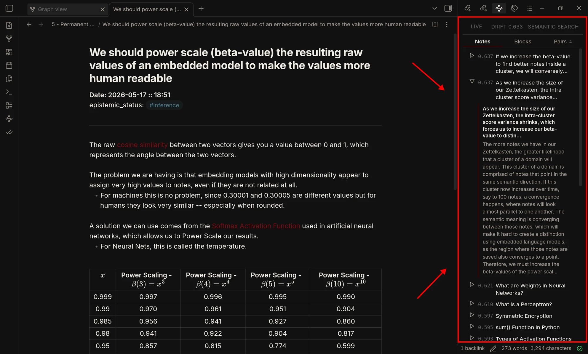
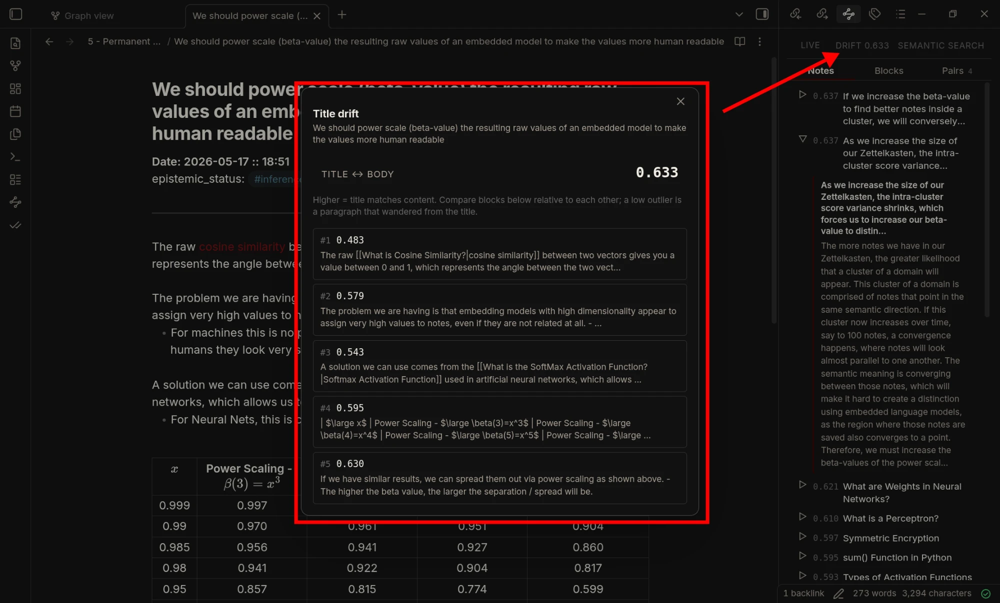
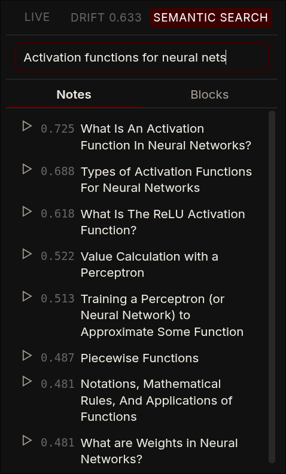

# Local Connections

An Obsidian plugin that shows which of your notes are related to the one you're reading. It runs on your own computer through Ollama, so your notes never leave your machine and there's nothing to pay for.

## Author Note / How things came to be

A similar (most popular) plugin for this problem (semantic cosine similarity) kept triggering a weird graphics bug/freeze on my MacBook, which then forced a full reboot after ~10 minutes of writing. Therefore, I started writing my own plugin. I wanted a free and minimalist design. No bells and whistles. Just does what it says and the user stays 100% in control with as little distractions as possible. Everything is local, no data collection. 

I do hope you enjoy this plugin. 

If you have any suggestions or recommendations, please [open an Issue](https://github.com/alt-n1tro/local-connections/issues/new) and I will look into it. :)

## What it does

Open a note and the side panel shows three tabs:

- **Notes**: other notes about the same thing.
- **Blocks**: single paragraphs from anywhere in your vault that match a paragraph in your note. This is the useful one for long notes like diary entries, where one paragraph can connect to something the rest of the note has nothing to do with.
- **Pairs**: notes with very different titles but similar content. These tend to be the surprising connections. The tab only appears when there are any.

A small number on a tab, like Blocks², tells you how many results in it are strong matches, so you notice them even while you're on another tab.

Notes you already link to are left out. Every result has a **Copy link** button.

Also in the panel:

- **Semantic search**: type a sentence and find notes and paragraphs by meaning, not exact words.
- **Drift**: how well the current note's title still fits what you wrote. Click it to see which paragraphs drift away from it.
- **Gravity**: a small box at the top of the Notes tab with notes your recent writing keeps coming back to. You can turn it off in the settings.
- **Pause**: stops re-indexing while you write. It catches up when you resume.

## What it looks like

The panel next to a note. Here one row is expanded to show the matching note's text:



Clicking **Drift** shows how well each paragraph fits the note's title:



Semantic search finds notes by meaning, even when they don't share the words you typed:



## What you need

- **Obsidian on a computer** (Windows, macOS or Linux). It doesn't run on mobile.
- **[Ollama](https://ollama.com)**, running on the same computer, with the `bge-m3` model downloaded (about 1.2 GB).
- Ollama has to be running while you use the plugin: it's needed whenever a new or edited note is indexed, and for semantic search.
- **Memory:** roughly 30 MB per 1,000 notes of four paragraphs each, so about 300 MB for 10,000.

## Setup

1. Install [Ollama](https://ollama.com) and download the model:

   ```
   ollama pull bge-m3
   ```

2. Download `main.js`, `manifest.json` and `styles.css` from the [latest release](https://github.com/alt-n1tro/local-connections/releases/latest) and put them in `<your vault>/.obsidian/plugins/local-connections/`.
3. In Obsidian, go to **Settings → Community plugins** and turn on Local Connections.
4. It asks which folders to index, with the folder of the note you have open already ticked. Pick what you want and click **Start indexing**.
5. Open the panel with the ribbon icon or the command palette.

The first run indexes everything in those folders, which can take a while on a big vault. After that, only notes you change are re-indexed.

If you skip step 4, nothing is indexed and the panel stays paused. Click **Paused** (or **Choose folders**) to pick folders later.

## What gets indexed

Only notes inside the folders you pick. Before a note is sent to the model, the plugin cleans it, so that only what you actually wrote is compared. The panel shows the cleaned text, so what you see there is exactly what was indexed. Your files are never changed.

**1. Parts that aren't writing are removed**

- properties at the top of the note (tags, aliases, dates and every other property)
- code blocks (` ``` ` or `~~~`), images and embedded notes or files
- comments (`%% … %%` and `<!-- … -->`) and block IDs like `^a1b2c3`
- horizontal rules (`---`, `***`, `___`)
- lines that contain only tags, like `#idea #topic/sub`
- link reference lines, like `[1]: https://example.com`
- lines starting with `Date:`, `epistemic_status:` or `->`
- transcript timestamps, like `[00:02:56 - 00:02:57] SPEAKER_00`

**2. Links keep only the words you see**

Where a link points to is not your writing, so it doesn't count.

| You wrote | What is indexed |
|---|---|
| `the [[Vector Dot Product\|dot product]] of two vectors` | the dot product of two vectors |
| `it builds on [[Some Other Note]] and more` | it builds on and more |
| `read [the docs](https://example.com/page) first` | read the docs first |

A line that held nothing but links, such as a `- [[Note]]` list item, is dropped.

**3. The rest is split into paragraphs**

A paragraph is text separated by blank lines. A list stays with the paragraph above it. Each paragraph is indexed separately (the Blocks tab), and the whole note is indexed once, together with its title (the Notes tab).

**4. Very short and very long texts**

- Notes with fewer than 100 characters left after cleaning are skipped.
- Paragraphs under 40 characters don't count as blocks.
- A note longer than about 28,000 characters is matched by its paragraphs only, because the model can't read that much at once.

These limits can be changed under **Advanced settings**.

**What stays in:** everything else, including headings, inline code, text in tables and callouts, tags inside a sentence, math, and web addresses written out as plain text.

## Settings

The settings page only shows the basics: the Ollama address and model, which folders to index, how many results to show, and the score at which a match counts as strong. Everything else is folded away under **Advanced settings**, and the defaults there are fine for most vaults.

## Privacy

The plugin only talks to your Ollama server (`http://localhost:11434` unless you change it). The index is saved as `vectors.bin` in the plugin's folder. If you're upgrading from an older version, your old `vectors.json` is converted automatically, checked number by number, and then removed.

## How it was made

Most of the code was written with AI, but not in one go. I've used it every day in my own vault for months and kept fixing and improving it as I went.

## License

[GPL-3.0](LICENSE)
